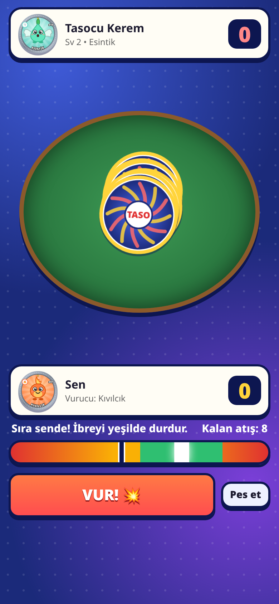
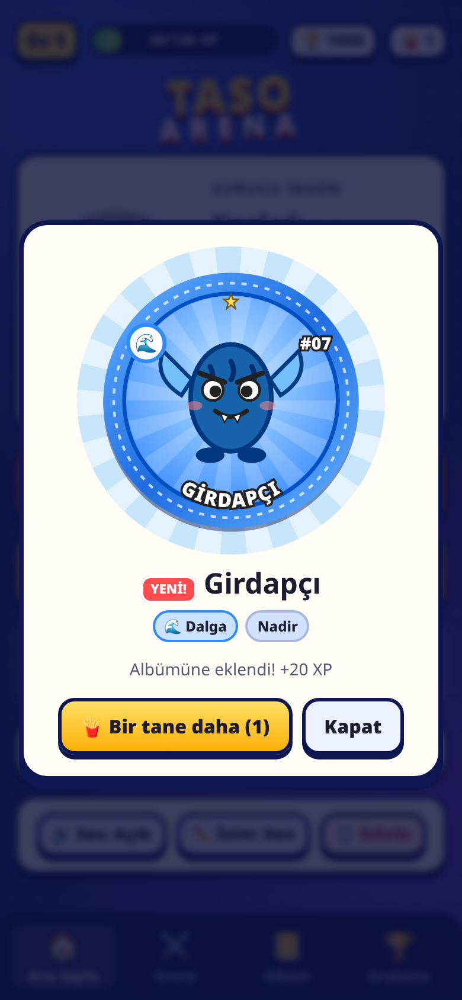
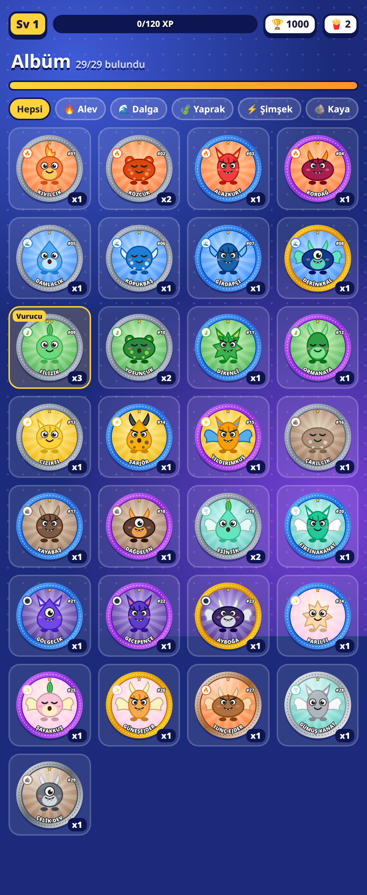

# 🥏 Taso Arena

90'ların cips paketlerinden çıkan tasolara nostaljik bir selam! Tarayıcıda (mobil + masaüstü) oynanan, **tamamen özgün yaratıklarla** bir taso çevirme oyunu.

**▶️ Oyna:** https://0xrenny.github.io/taso-arena/

<p align="center">  </p>

## Nasıl oynanır?
1. İlk tasonu seç (Kıvılcık 🔥, Damlacık 🌊 veya Filizik 🍃).
2. Arenada bir rakibe meydan oku. İkiniz de ortaya 3'er taso koyarsınız, tasolar ters çevrilip üst üste dizilir.
3. Güç metresindeki ibreyi **yeşil bölgede** durdur ve **VUR!** (Boşluk/Enter tuşu ya da sahaya dokunmak da olur). Parlak beyaz çizgi = **MÜKEMMEL** vuruş.
4. Yüzü yukarı dönen her taso vuranın olur. Sırayla toplam 8 atış yapılır; en çok taso çeviren kazanır.
5. Kazandıkça XP, sıralama puanı ve 🍟 cips paketi kazan. Aynı tasodan topladıkça tason ⭐ seviye atlar.

## Özellikler
- **29 özgün taso**, 8 element (Alev, Dalga, Yaprak, Şimşek, Kaya, Rüzgar, Gölge, Işık) ve 5 nadirlik: Sıradan, Nadir, Epik, Efsanevi ve parlayan **Metal** tasolar.
- Tüm taso çizimleri kodla (SVG) üretilir; hiçbir hazır görsel ya da telifli içerik yoktur.
- Statlar: **Güç** (vuruş), **Ağırlık** (çevrilmeye direnç), **Şans** (şanslı vuruş). Element avantajı çevirme şansını ×1.3 artırır.
- Fizik hissi veren animasyonlar: tasonun yığına inişi, şok dalgası, ekran sarsıntısı, havada dönen tasolar, WebAudio ses efektleri.
- İlerleme: oyuncu seviyesi, taso seviyeleri (1/3/6/10/15 kopya), albüm (bulunan / eksik), cips paketi açma animasyonu.
- **Sıralama tablosu:** 15 yapay zekâ rakip, Elo puanı. Botlar arka planda kendi aralarında da maç yapar.
- Tüm ilerleme `localStorage`'da saklanır.

## Geliştirme
```bash
npm install
npm run dev      # geliştirme sunucusu
npm test         # Vitest birim testleri (savaş, seviye, koleksiyon, sıralama, kayıt)
npm run build    # dist/ klasörüne statik çıktı
python3 e2e/smoke.py http://localhost:4173/   # (npm run preview ile) Playwright duman testi
```
`main`'e her push'ta GitHub Actions testleri çalıştırır, build alır ve GitHub Pages'e yayınlar.

### Kod yapısı
- `src/data/creatures.js` – yaratıklar, elementler, avantajlar, nadirlikler
- `src/logic/` – saf oyun mantığı (UI'dan bağımsız, test edilebilir): `battle.js`, `collection.js`, `progression.js`, `ranking.js`, `game.js`, `storage.js`
- `src/ui/art.js` – prosedürel SVG taso çizimi, `src/ui/audio.js` – ses efektleri
- `src/main.js` – ekranlar ve etkileşim

## Gerçek çevrim içi sıralama nasıl eklenir?
Şu an sıralama cihazda tutulur ve rakipler bottur. Gerçek bir küresel tablo için:
1. Küçük bir backend ekleyin (ör. **Supabase**, **Firebase** veya bir **Cloudflare Worker + D1/KV**). Tablo: `players(id, name, points, level, updated_at)`.
2. Maç sonunda `applyMatch` sonucu (puan değişimi) bu API'ye gönderilir; `leaderboard()` bot listesi yerine API'den gelen ilk 100 kaydı gösterir.
3. Hile önlemek için maç sonucu sunucuda doğrulanmalıdır: istemci sadece vuruş isabetlerini (`quality` değerleri) gönderir, sunucu aynı tohumlu RNG ile `resolveHit` mantığını çalıştırıp sonucu hesaplar (mantık zaten UI'dan bağımsız olduğu için sunucuda aynen kullanılabilir).
4. Oyuncu kimliği için anonim giriş (Supabase/Firebase anonymous auth) yeterlidir.

## Telif notu
Bu proje 90'ların taso oyunlarından ilham alır ancak **hiçbir lisanslı karakter, isim veya görsel içermez**. Tüm yaratıklar, isimler ve çizimler bu projeye özgüdür.
